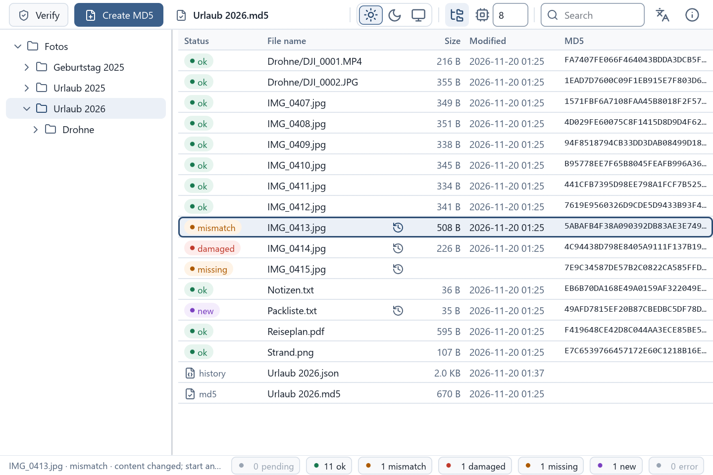

# Veritas

**MD5 checksums for folders, with a history of every change and a structure check that tells you whether a mismatching media file is still intact.**

Veritas (Latin "truth") is a lean, local tool for media and file collections: hash fast, use little memory, no cloud, no account. The interface is native (egui), without a web view, in English, German, French, Spanish or Italian: on first start it follows the system language; the language button next to *i* or Ctrl+L switches.

<picture><source media="(prefers-color-scheme: dark)" srcset="screenshots/veritas-main-dark.png"></picture>

## What it does

- **Create** – `{folder name}.md5` in md5sum format, with or without subfolders.
- **Verify** – shows which files match, differ, are new or are missing; also reads SHA checksum files from other tools (`.sha1`, `.sha256`, `.sha512`, `SHA256SUMS` …), writing is always MD5.
- **History** – every run is recorded in `{folder name}.json`; the clock icon on a file shows when it changed.
- **Structure check** – on a mismatch, Veritas checks the head and tail of JPEG, PNG, HEIC, TIFF, MP4/MOV, MKV, AVI, WebP, PDF and Office files.
- **Open without waiting** – a folder shows at once what the `.md5` expects; hashing starts only on verify.
- **Fast and frugal** – several threads on SSDs, one file at a time on spinning hard disks (HDD), buffered reads.
- **Safe deleting** – only into the trash (Recycle Bin on Windows), always after a confirmation; the `.md5` and the history stay.
- **Keyboard first** – every common action has a key, and the tooltip names it.

## Install

Download from [Releases](https://github.com/fly2nbc-oss/Veritas/releases):

| File | For |
|---|---|
| `veritas_<version>_x64-setup.exe` | Windows 10/11 – installs for your user, no admin rights |
| `veritas_<version>_x64-portable.zip` | Windows – unzip and run `Veritas\veritas.exe` |
| `veritas_<version>_x86_64.AppImage` | Linux (Ubuntu 24.04, Debian 13 or newer) |
| `veritas_<version>_amd64.deb` | Ubuntu 24.04+ / Debian 13+ – `sudo apt install ./veritas_<version>_amd64.deb` |

The Windows files are not signed yet: SmartScreen asks once (*More info* → *Run anyway*). Linux needs OpenGL and `libxkbcommon-x11`.

## The most important keys

| Key | Does |
|---|---|
| Ctrl+Enter | Create MD5 |
| F5 | Verify |
| Ctrl+H | History (of the selected file) |
| Del | Move to the trash, with a confirmation |
| Ctrl+F | Search |
| F8 | Next file with a finding |
| F1 | About Veritas, report a bug |
| Esc | One level back; during a run, twice: cancel |

All keys, formats and limits: [manual](docs/manual.md).

## Privacy

Veritas writes only `{folder name}.md5` and `{folder name}.json` into the chosen folder. The settings, the run log `veritas.log` and, after a crash, `crash.log` are in `%APPDATA%\Veritas\data` on Windows and in `~/.local/share/veritas` on Linux.

Veritas works locally only, without telemetry and without an update check. This program will not transfer any information to other networked systems unless specifically requested by the user or the person installing or operating it.

## More

[Contributing and building](CONTRIBUTING.md) · [Changelog](CHANGELOG.md) · [Security](SECURITY.md) · [License](LICENSE) · [Third-party components](THIRD_PARTY.md) · [Code of conduct](CODE_OF_CONDUCT.md)
